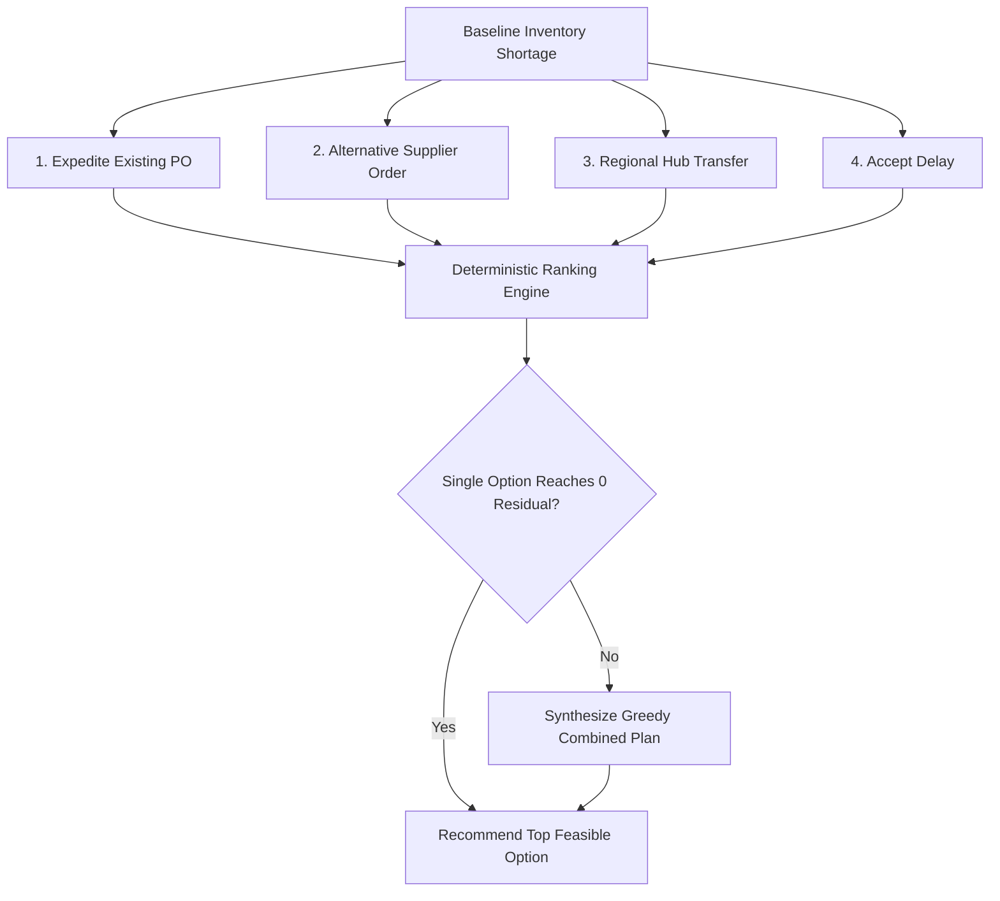

# SupplyChain Sentinel AI — Recovery Recommendations Architecture

## 1. Executive Summary & Purpose

In **Phase 7**, SupplyChain Sentinel AI introduces prescriptive decision-support for inventory shortages. When the inventory projection identifies a projected component stockout (`risk_level` in `critical`, `high`, or `medium`), the recovery engine automatically evaluates four distinct intervention strategies against real stored procurement contracts and warehouse stock balances.

> [!IMPORTANT]
> **Strict Non-Execution Safeguard**:
> SupplyChain Sentinel AI is exclusively a **decision-support advisory tool**. It **NEVER** creates, alters, or executes real purchase orders, inter-warehouse transfer orders, or enterprise transactions. There is **NO SAP connection** and all operational inputs are derived from synthetic demo data anchored to a fixed evaluation date (`as_of: 2026-10-17`).

---

## 2. Target Definition & Shortage Scope

1. **Target Need**:
   $$\text{need\_units} = \lceil \text{unmet\_before\_next\_inbound} \rceil$$
   The recovery target is strictly the volume of projected customer demand that cannot be fulfilled before the next inbound replenishment arrives at the plant warehouse.
2. **Later Shortage Scope**:
   Interventions are designed to bridge the immediate shortage runway up to the next counted replenishment event (`target_cutoff`). Any later shortage episodes occurring after subsequent replenishment dates are identified, reported, and labelled:
   > *"Later shortage episode begins YYYY-MM-DD (X units over Y days); not covered by this recommendation."*
3. **No-Shortage Invariance**:
   Components with `risk_level` in `low`, `none`, or `unknown` (or where `unmet_before_next_inbound <= 0`) have no active shortage runway and are omitted from the recommendations response.

---

## 3. Intervention Strategies (Candidate Options)

Each candidate option is evaluated deterministically by cloning the domain inputs with the proposed action applied, and re-executing `evaluate_component`:

### 3.1. Expedite Existing Purchase Order (`expedite_existing`)
- **Applicability**: Evaluated for the earliest counted plant inbound PO line whose supplier offer has `expedite_available = True` and non-null `expedite_lead_time_days`.
- **Scheduled Arrival**: $\text{new\_arrival} = \text{as\_of} + \text{expedite\_lead\_time\_days}$.
- **Feasibility Rule**: Feasible **only** if $\text{new\_arrival} < \text{current\_expected\_date}$. If the expedited date is not earlier than the currently scheduled date, the option is marked `feasible = False` with the reason clearly stated.
- **Quantity**: The PO line's full remaining unfulfilled quantity ($\text{qty\_ordered} - \text{qty\_received}$).
- **Incremental Cost**:
  $$\text{cost} = \text{remaining\_qty} \times \text{unit\_cost} \times \text{expedite\_cost\_premium\_pct}$$
  If `expedite_cost_premium_pct` is `null`, the cost is marked unknown (`cost_known = False`), flagged `expedite_premium_unknown`, and sorting ranks it after known-cost options.

### 3.2. Alternative Supplier Order (`alternative_supplier`)
- **Applicability**: Evaluated for each supplier offering the component other than the supplier on the shortage inbound line.
- **Order Quantity**: $\text{order\_qty} = \max(\text{need\_units}, \text{min\_order\_qty})$.
- **Capacity Constraint**:
  - If $\text{max\_weekly\_capacity}$ is declared and $\text{target\_qty} > \text{max\_weekly\_capacity}$, the order is capped at $\text{max\_weekly\_capacity}$ and flagged `capped_at_max_weekly_capacity`. It never exceeds supplier capacity.
  - If $\text{max\_weekly\_capacity} < \text{min\_order\_qty}$, the option is marked `feasible = False` with the reason stated.
  - If $\text{max\_weekly\_capacity}$ is unstated (`null`), the full order is allowed and flagged `capacity_unknown_assumed_available`.
- **Arrival Date**: $\text{arrival\_date} = \text{as\_of} + \text{lead\_time\_days}$.
- **Cost & Premium**:
  $$\text{cost} = \text{order\_qty} \times \text{unit\_cost}$$
  $$\text{unit\_premium} = \text{offer.unit\_cost} - \text{shortage\_supplier.unit\_cost}$$

### 3.3. Regional Warehouse Stock Transfer (`transfer`)
- **Applicability**: One option per regional warehouse with usable stock ($on\_hand - reserved > 0$).
- **Quantity**: $\text{xfer\_qty} = \min(\text{usable\_stock}, \text{need\_units})$.
- **Arrival Date**: $\text{arrival\_date} = \text{as\_of} + \text{transfer\_days}$ (configurable default: 2 days).
- **Incremental Cost**:
  $$\text{cost} = \text{xfer\_qty} \times \text{transfer\_cost\_per\_unit}$$
  If `RECOVERY_TRANSFER_COST_PER_UNIT` is unconfigured (`null`), cost is marked unknown (`cost_known = False`) and flagged `transfer_cost_unknown`.
- **Infeasibility**: Regional hubs with 0 usable stock are listed with `feasible = False` and reason *"Regional warehouse X has zero usable stock"*.

### 3.4. Accept Delay (`accept_delay`)
- **Quantity**: 0.
- **Cost**: $0.00.
- **Residual**: Equals baseline $\text{unmet\_before\_next\_inbound}$.
- **Customer Exposure**: Reuses the Phase 6 customer order impact engine to enumerate open and in-production customer orders due during the shortage window.
- **Mandatory Caveat**:
  > *"Upper bound of exposure: production lead time and stock allocation to orders are unknown, so these orders are potentially exposed, not predicted to be late. Exposed revenue is the selling value of those orders, not an estimate of loss."*

---

## 4. Deterministic Recommendation Selection Rule

The recommendation engine selects the winning option among all feasible candidate options (and the combined plan if synthesized) using a deterministic 4-stage hierarchy:

1. **Smallest Residual Unmet Demand**: Prefer the intervention leaving the smallest `residual_unmet_before_next_inbound`.
2. **Lowest Known Incremental Cost**: Among options with equal residual, prefer the lowest known incremental cost. Known costs always sort before unknown costs.
3. **Earliest Arrival Date**: Among equal residual and cost, prefer the earliest arrival date at the plant.
4. **Deterministic Option ID**: Tie-breaker by alphanumeric option ID.

Never recommends an infeasible option. Never claims global optimality.

---

## 5. Greedy Combined Plan

If no single feasible intervention eliminates the shortage (`residual_unmet_before_next_inbound == 0`), the engine synthesizes a multi-action plan:
1. **Transfers First**: Apply available regional warehouse stock (known cost first, then unknown cost), up to each warehouse's usable stock.
2. **Expedite Second**: Apply existing PO expedite if available and earlier.
3. **Alternative Supplier Third**: Apply alternative suppliers up to their declared weekly capacity (lowest unit cost first).
4. **Stopping Condition**: Halts as soon as residual unmet demand reaches 0.0 or no further feasible actions remain.

---

## 6. Worked Example: CPU-X7 (Seed 42, As-Of 2026-10-17)

### Baseline Disruption Profile
- **Component**: CPU-X7 (High-Performance Processor 8-Core), ID 1.
- **Usable Plant Stock**: 250 units.
- **Mean Daily Demand**: ~104.7 units/day (weekday profile).
- **First Shortage Date**: 2026-10-21 (runout after 4 days).
- **Next Replenishment**: PO-CPU-701 from `SUP-HELIX` (800 units, promised 2026-10-24).
- **Unmet Demand Before Next Replenishment**: **289.5 units** ($\text{need\_units} = 290$).
- **Later Shortage**: Episode 2 begins 2026-11-02 (4498.0 units over 44 days).

### Evaluated Interventions

| Option ID | Kind | Source | Qty | Arrival | Cost ($) | Residual (units) | Feasible | Recommended |
| :--- | :--- | :--- | :---: | :---: | :---: | :---: | :---: | :---: |
| `alt_supplier.SUP-NEXUS` | `alternative_supplier` | SUP-NEXUS | 290 | 2026-10-21 | $85,550.00 | **0.0** | **Yes** | **★ Recommended** |
| `expedite.PO-CPU-701` | `expedite_existing` | SUP-HELIX | 800 | 2026-10-22 | $50,000.00 | 36.2 | **Yes** | Runner-up |
| `transfer.WH-REG-EAST` | `transfer` | WH-REG-EAST | 150 | 2026-10-19 | Unknown | 139.5 | **Yes** | No |
| `transfer.WH-REG-WEST` | `transfer` | WH-REG-WEST | 50 | 2026-10-19 | Unknown | 239.5 | **Yes** | No |
| `transfer.WH-REG-EMPTY` | `transfer` | WH-REG-EMPTY | 0 | 2026-10-19 | Unknown | 289.5 | **No** (Zero stock) | No |
| `accept_delay` | `accept_delay` | — | 0 | — | $0.00 | 289.5 | **Yes** | No |

### Decision Analysis
- `alt_supplier.SUP-NEXUS` is selected as the **recommended option** because its 4-day lead time allows delivery on 2026-10-21 (the exact day shortage begins), supplying 290 units within its weekly capacity of 300 units, leaving **0.0 units** residual unmet demand before PO-CPU-701 arrives on 2026-10-24.
- `expedite.PO-CPU-701` arrives on 2026-10-22 (5-day expedite lead time), leaving 36.2 units unmet during 2026-10-21 before receipts arrive at the start of 2026-10-22.
- Because `alt_supplier.SUP-NEXUS` achieves residual 0.0, no combined plan is required (`combined_plan: null`).

---

## 7. Assumptions and Known Limitations

1. **Assumptions vs. Contractual Data**:
   - Supplier unit cost, lead time, MOQ, capacity, and expedite terms are stored contract terms.
   - Inter-warehouse transfer time (`transfer_days = 2`) and cost (`transfer_cost_per_unit = null`) are user-configurable assumptions (`RECOVERY_TRANSFER_*`).
2. **First Shortage Horizon Target**:
   - Interventions target the immediate stockout runway. They do not simulate inventory rebalancing across multiple successive years.
3. **Single Plant Destination**:
   - Model evaluates replenishment into the central plant warehouse (`WH-PLANT-01`).
4. **Heuristic Decision Support**:
   - The engine provides deterministic heuristic ranking and greedy synthesis; it does not solve non-linear mixed-integer multi-echelon optimization problems.
